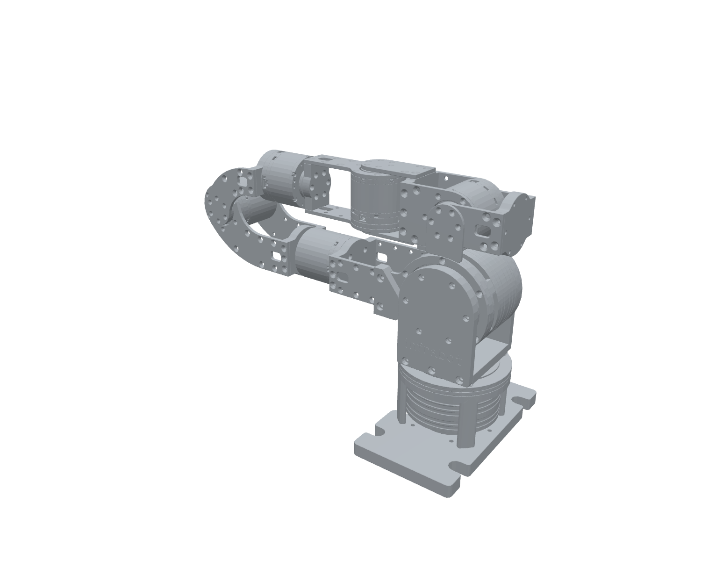

# InfraBot Firmware

English · [简体中文](README.zh-CN.md)

STM32H743 firmware for the InfraBot H7C seven-axis arm, with a 1 kHz motor loop, onboard touchscreen and Ethernet SDK interface.



## Hardware and control

- Fire H743 Challenger V2 with LAN8720A Ethernet, SDRAM and a 4.3-inch 480×272 or 5-inch 800×480 RGB touch panel. [4.3-inch baseboard](https://github.com/YaolinDong/infrabot-pcb-4p3)
- Seven Damiao CAN FD joints and an optional J8 gripper. Kinematics and gravity compensation use the H7C bare-arm model. [Robot description](https://github.com/YaolinDong/infrabot-description)
- Joint and Cartesian RT/NRT commands, local inverse kinematics, gravity compensation, impedance and admittance control. The LCD shows drive status, network configuration and a 3D arm view. Signed A/B updates support trial boot and rollback.

## Quick start

On Ubuntu, install the toolchain and build both application slots and the loader.

```sh
sudo apt install cmake ninja-build gcc-arm-none-eabi libnewlib-arm-none-eabi libstdc++-arm-none-eabi-newlib python3 build-essential
cmake --preset Release
cmake --build --preset Release --parallel 4
```

For a new board provision the matching factory image over SWD. On a provisioned board use the SDK's `./flash-net --package /path/to/infrabot_firmware.ifw` or `./flash-swd --package /path/to/infrabot_firmware.ifw`. Support the arm, disable drives and disconnect motor power first. [Build options](docs/build.md) · [Signing, provisioning and updates](docs/flashing.md) · [Ethernet recovery (Chinese)](docs/ethernet-update.md)

## Firmware layout

| Directory | Responsibility |
| --- | --- |
| `boards/`, `drivers/` | Board startup, HAL adapters, CAN, Ethernet, display and touch |
| `app/`, `control/` | RTOS tasks, supervision, trajectories, kinematics and control laws |
| `ui/`, `models/` | Panel pages and generated assets, robot model inputs |
| `protocol/`, `bootloader/` | Wire formats, signed A/B boot and recovery |
| `third_party/`, `tools/`, `tests/` | Pinned dependencies, build utilities and offline tests |

## Operation and safety

The controller boots with motors disabled. STOP normally brakes to an enabled hold. Feedback, stream, speed and joint limits are software supervision. Provide an independent hardware emergency stop for drive-power isolation. [Safety and stop behavior](docs/safety.md)

[Architecture (Chinese)](docs/architecture.md) · [Control modes (Chinese)](docs/control-modes.md) · [Blocking motion (Chinese)](docs/blocking-motion.md) · [Impedance](docs/impedance-control.md) · [Admittance (Chinese)](docs/admittance-control.md) · [LCD (Chinese)](docs/lcd.md) · [Protocol (Chinese)](docs/protocol.md) · [Testing](docs/testing.md)

Project code is licensed under Apache-2.0. Third-party software and fonts retain their own terms. [License](LICENSE) · [Third-party notices](THIRD_PARTY.md)
