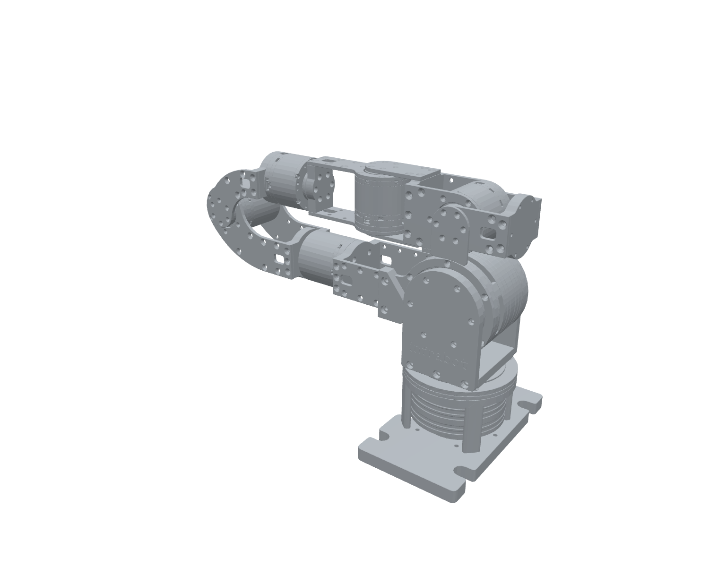

# InfraBot 固件

[English](README.md) · 简体中文

面向 InfraBot H7C 七轴机械臂的 STM32H743 固件，提供 1 kHz 电机控制、板载触摸屏和以太网 SDK 接口。



## 支持的硬件与功能

- 野火 H743 挑战者 V2，LAN8720A 以太网和外部 SDRAM，支持 4.3 寸 480×272、5 寸 800×480 RGB 触摸屏。[4.3 寸底板](https://github.com/YaolinDong/infrabot-pcb-4p3)
- J1–J7 使用达妙 CAN FD 电机，可选 J8 夹爪。运动学和重力补偿使用 H7C 裸臂模型。[机械臂模型](https://github.com/YaolinDong/infrabot-description)
- 支持关节与笛卡尔 RT/NRT 模式、MCU 逆解、重力补偿、阻抗和导纳。屏幕可查看状态、设置网络和显示三维模型。A/B 分区支持签名升级、试启动与回滚。

## 快速开始

在 Ubuntu 安装工具链并构建 Release。生成的 A/B 应用镜像和 Loader 位于 `build/Release/`。

```sh
sudo apt install cmake ninja-build gcc-arm-none-eabi libnewlib-arm-none-eabi libstdc++-arm-none-eabi-newlib python3 build-essential
cmake --preset Release
cmake --build --preset Release --parallel 4
```

新板使用 SWD 安装配套的 factory 镜像。已安装 A/B Loader 的板子可在 SDK 目录运行 `./flash-net --package /path/to/infrabot_firmware.ifw`，或通过调试器运行 `./flash-swd --package /path/to/infrabot_firmware.ifw`。烧录前支撑机械臂、失能并断开电机动力，保留控制板供电。[构建选项](docs/build.md) · [签名与烧录](docs/flashing.md) · [分区与恢复](docs/ethernet-update.md)

## 目录与文档

| 目录 | 内容 |
| --- | --- |
| `boards/`、`drivers/` | 板级启动、HAL 适配、CAN、以太网、显示和触摸 |
| `app/`、`control/` | RTOS 任务、状态监控、轨迹、运动学与控制律 |
| `ui/`、`models/` | 界面资源与机械臂模型 |
| `protocol/`、`bootloader/` | 线协议、签名 A/B 启动与恢复 |
| `third_party/`、`tools/`、`tests/` | 固定版本依赖、构建工具与离线测试 |

控制器上电后电机失能。STOP 通常使机械臂刹停并保持使能。反馈、断流、速度和关节限位由软件监控，切断驱动动力需要独立硬件急停。[安全与停止语义](docs/safety.md)

[架构](docs/architecture.md) · [控制模式](docs/control-modes.md) · [阻抗](docs/impedance-control.md) · [导纳](docs/admittance-control.md) · [触摸屏](docs/lcd.md) · [协议](docs/protocol.md) · [测试](docs/testing.md)

项目代码采用 Apache-2.0。第三方组件和字体按各自许可分发。[项目许可证](LICENSE) · [第三方声明](THIRD_PARTY.md)
